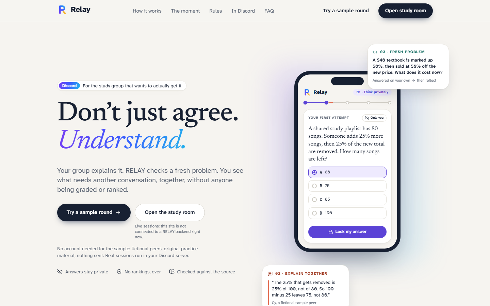

<p align="center">
  
</p>

<h1 align="center">RELAY</h1>
<p align="center"><strong>Don’t just agree. Understand.</strong><br>
Your group explains it. RELAY checks a fresh problem. A Discord study-group assistant, DEVHACKS Track 3.</p>



**The problem:** in a study group chat the fastest person posts the answer, everyone nods, and three
people leave thinking they understood it. "It makes sense" is not "I can apply it."

**RELAY** runs a short session in your Discord server (the website is its companion):

**Gather → Think privately → Explain together → Fresh problem → Reflect**

Everyone answers alone first. A peer explains, with the reviewed source, not the majority, as the
check. Then a *different* problem on the same idea, answered alone again, and a private receipt: what
was checked, what you did, and one honest next step. It never grades, ranks or claims mastery. It can
also find a time everyone can make, as a supporting step.

**Watch it:** `/tour` is a two-minute narrated walkthrough of a session in Discord, from set-up and
sign-in to the receipt (MP4: `web/public/tour/relay-tour.mp4`). It is a recreation with a fictional
group; RELAY's own screens use its real components.

**Try it:** `/demo` plays one round in your browser with fictional peers and original practice
material; nothing is sent. Real sessions start with `/relay create` in Discord.

## What's in the repo

| Path | What | Owner |
|---|---|---|
| `relay/` | FastAPI backend, state machine, scheduling, jobs, Discord OAuth, Gemini adapter (optional), Discord bot | Rithik |
| `web/` | Next.js 16 study room, scheduler, debrief, landing page and synthetic demo (`web/src`); legacy static UI (`index.html`, `app.js`, `style.css`) | frontend |
| `n8n/` | Three workflow templates: reminders, delayed practice + retention purge, error handler | Rithik |
| `contracts/` | `openapi.json` and synthetic response fixtures (the frontend's source of truth) | Rithik |
| `data/` | Original synthetic teaching material (not ASU course content) | Rithik |
| `tests/` | Backend tests (pytest), incl. PostgreSQL and real-HTTP tests | Rithik |
| `docs/` | Design, API, deployment, runbooks; `docs/design/` holds frontend plan, decisions, logo, screenshots | both |

## Quick start (Windows PowerShell)

Requires Python 3.11+ and Node 24.

```powershell
# 1. Backend (local test mode: synthetic identities on, model and delivery off)
py scripts/setup_local.py --install           # creates .venv and a local .env with a private key
$env:RELAY_SERVE_WEB="false"; .\.venv\Scripts\python.exe -m uvicorn relay.api:app --host 127.0.0.1 --port 8000

# 2. Web app (second terminal)
cd web
npm install
npm run build
$env:RELAY_API_BASE_URL="http://127.0.0.1:8000"; npx next start -H 127.0.0.1 -p 3001
```

Open **http://127.0.0.1:3001**. `/demo` is the sample round; `/demo/stages` shows every stage as
captured from the backend; `/room` creates real local sessions with test identities (not real accounts). macOS/Linux: use `.venv/bin/python`.

**Discord bot** (third terminal, needs `DISCORD_BOT_TOKEN` and `DISCORD_GUILD_ID` in `.env`; set
them with `.\.venv\Scripts\python.exe scripts\set_env_secret.py DISCORD_BOT_TOKEN`, hidden input):

```powershell
.\.venv\Scripts\python.exe -m relay.bot
```

Then in your server: `/relay create`, `/relay join`, `/relay next`, `/relay question`, `/relay explain`,
`/relay hint`, `/relay challenge`, `/relay review`, `/relay resolve`, `/relay availability`,
`/relay schedule`, `/relay reminders`, `/relay status`, `/relay leave`, `/relay delete`.

## Data modes in the web app (always labeled on screen)

- **Synthetic** — `/demo` and the landing page render committed fixtures. Nothing is sent.
- **Local test identities** — backend with `RELAY_PUBLIC_DEMO=true` (never in production).
- **Connected** — Discord sign-in (OAuth, HttpOnly cookie + CSRF); sessions start in Discord.
- **Not connected** — no backend configured; live screens say so and point to the demo.

## Connecting the website to the backend

The deployed site currently shows "Backend not connected": the laptop backend has no public HTTPS
address yet. Root cause, the exact variables, and the $0 runbook (Tailscale Funnel or a Cloudflare
Quick Tunnel to the public listener only) are in `docs/LIVE_CONNECTION_DIAGNOSIS.md`.

## Hosting ($0)

No paid hosting is used. The backend, bot and SQLite run on a laptop; Tailscale Funnel can publish
only the public API listener over HTTPS (`python -m relay.local_host init|check|start`, see
`docs/LOCAL_PUBLIC_HOSTING.md`). The Next.js app can be deployed on Vercel's free plan with root
directory `web` and `RELAY_API_BASE_URL` pointing at the backend. A Railway plan is documented but
paused (`docs/DEPLOYMENT.md`).

## Checks

```powershell
.\.venv\Scripts\python.exe -m pytest                     # backend: 154 passed, 5 skipped (PostgreSQL tests need a DB URL)
.\.venv\Scripts\python.exe -m compileall -q relay scripts
node --check web/app.js                                  # legacy UI
cd web; npm run lint; npm run typecheck; npm test; npm run build
$env:RELAY_PYTHON="..\.venv\Scripts\python.exe"; npm run test:e2e   # 28 browser tests vs a temporary local FastAPI
```

## What has actually been verified

| Verified | How |
|---|---|
| Full Discord study session with two real accounts | Live, private test server (create → join → private answers → discussion → fresh problem → debrief), plus challenge → review → resolve and delete |
| Backend boundaries | 154 pytest tests incl. privacy, stale buttons, concurrency, OAuth/CSRF, jobs, `allowed_actions` probed against the real rules, receipts; 5 PostgreSQL 16 tests in Docker |
| Production mode | Local rehearsal: unmigrated boot refused, demo/bearer/internal refused, secure cookies, restart persistence |
| n8n templates | Imported and executed in n8n 2.44.6 (Docker) against a dry-run API |
| Web app | 101 unit + 28 Playwright tests: sample round with zero backend calls, four-student live loop on desktop and phone, draft preservation under background updates, 409 recovery, axe at 360–1920px; the sample engine is checked view for view against backend replays |

**Not verified:** a deployed backend or Vercel site, Discord sign-in through a real domain, a live
AI model call, a real reminder DM, published n8n schedules, real students. Details in
`TEST_REPORT.md` and `docs/BACKEND_PROGRESS.md`.

## Privacy

Answers stay private until Reflect; group totals appear only with at least three paired responses and
are not anonymous in small groups. The AI (if ever enabled) sees the reviewed source, the question and
option counts, never names or typed reasoning. Leaving a session removes your answers, reasoning,
availability and pending reminders; the host can delete a session; a cleanup job purges sessions older
than the retention period (30 days by default). Messages already posted in Discord are not retracted.
Never commit `.env`, databases, tokens or real student data.

## Docs

- `CLAUDE.md` — shared instructions for coding assistants
- `docs/API_CONTRACT.md` — every route, field and error · `docs/NEXTJS_BACKEND_HANDOFF.md` — proxy, auth, cookies
- `docs/LOCAL_PUBLIC_HOSTING.md` — $0 hosting · `docs/DEPLOYMENT.md` — hosted plan (paused)
- `docs/DEMO_RUNBOOK.md` — Discord demo script · `docs/N8N_RUNBOOK.md` — workflows and delivery safety
- `docs/BACKEND_PROGRESS.md` — backend status and next steps · `TEST_REPORT.md` — what ran
- `docs/product/PRODUCT_JOURNEY.md` — journey, routes, data modes, connection states · `docs/product/REFERENCE_AUDIT.md`
- `docs/LIVE_CONNECTION_DIAGNOSIS.md` — why the site is disconnected and how to connect it · `docs/CONTENT_PACKS.md` — Iris (CC BY 4.0, draft)
- `docs/design/` — frontend plan, decisions, API requests, logo (`docs/design/logo/`), screenshots
- `docs/TECHNICAL_DESIGN.md`, `docs/PRODUCT_AND_BUILD_PLAN.md`, `docs/RESEARCH.md` — design background
- `docs/REPO_SETUP.md`, `docs/CODING_AGENT_HANDOFF.md`, `docs/prompts/` — original bootstrap notes (historical)

## Team

**Rithik** — backend, Discord bot, AI, database, auth, scheduling, n8n, deployment.
**Dev** — frontend, design and Vercel. **Sankalp** and **Kanha** — bounded reviews.
