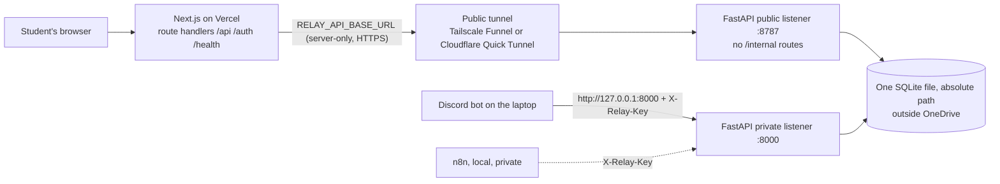

# Why the deployed site says "Backend not connected", and how to connect it ($0)

Investigated 2026-10-25 against https://relay-two-lovat.vercel.app and this repository.

## 1. What the screen means (traced in code)

| Step | Where | What happens |
|---|---|---|
| The room page asks whether a backend exists | `web/src/lib/connection.ts` → `GET /connection` | Runs in the browser at request time (route is `force-dynamic`, `no-store`; never baked into the build) |
| `/connection` checks the server setting | `web/src/app/connection/route.ts` → `upstreamConfig()` in `web/src/lib/proxy.ts` | Reads the **server-only** variable `RELAY_API_BASE_URL`; if it is set, calls `<origin>/health` with a 4 s timeout |
| Not usable → designed state | `NotConnected` in `web/src/components/states.tsx` | Shows "Backend not connected" and the reason; live data is never replaced with sample data |
| Every proxied call agrees | `proxy()` in `web/src/lib/proxy.ts` | Returns 503 `{code: "backend_not_connected", reason}` instead of guessing |

Reason codes (new in this change, so the site can say *which* problem it is without revealing the address):
`not_configured` (variable empty) · `invalid_url` · `local_address` (localhost/LAN on Vercel, which can never reach a laptop) · `unreachable` (no answer: laptop, API or tunnel offline) · `unhealthy` (non-2xx).

## 2. What the deployed site actually returned (probed 2026-10-25, before this change)

```
GET /connection        200 {"connected":false}
GET /health            503 {"detail":"Backend not connected","code":"backend_not_connected"}
GET /auth/me           503 backend_not_connected
GET /api/me/sessions   503 backend_not_connected
GET /internal/jobs     404 (never forwarded: correct)
```

**Cause.** The deployment has no reachable backend: either `RELAY_API_BASE_URL` is not set for the
Production environment, or it points at an address Vercel cannot reach. Both are certain to fail today
for one reason: **the laptop backend has no public HTTPS address yet** (Tailscale and cloudflared are
not installed; no tunnel has ever run). The working Discord rounds used the bot → `http://127.0.0.1:8000`
on the laptop, which Vercel can never call. The old build could not tell these cases apart; once this
change is deployed, `/connection` returns the exact `reason`.

**Not the cause:** CORS (the browser only talks to the same origin), OAuth (never reached), a build-time
flag (checked at request time), or the proxy's path mapping (unit-tested; `/api/...` maps once to
`<origin>/api/...`, the origin's path is dropped so `/api/api` cannot happen).

Not verifiable from here: the Vercel project's settings and which commit it runs (no dashboard access;
whoever owns the Vercel project must check).

## 3. The one architecture (both surfaces, one API, one database)



`python -m relay.local_host start` runs both listeners on the same database: the **public** one
(`RELAY_EXPOSE_INTERNAL=false`, port 8787) is the only thing the tunnel may expose; the bot and n8n stay
on the private one. Relative SQLite paths now resolve to the repo root (tests/test_product_slice.py), so
two processes can no longer create two databases by starting in different folders.

## 4. Environment variables (names verified in code)

| Variable | Where | Secret | Value | After changing |
|---|---|---|---|---|
| `RELAY_API_BASE_URL` | Vercel → Project → Settings → Environment Variables, **Production** | no | the tunnel origin, `https://…` (never localhost, a LAN IP, or the Vercel site itself) | **Redeploy** (env changes apply only to new deployments) |
| `NEXT_PUBLIC_DISCORD_INVITE_URL` | Vercel, optional | no | server invite link | Redeploy |
| `RELAY_FRONTEND_URL` | laptop production env (`relay.local_host init`) | no | `https://relay-two-lovat.vercel.app` (stable; also used by the bot for room links) | restart API + bot |
| `RELAY_ALLOWED_ORIGINS` | laptop | no | `https://relay-two-lovat.vercel.app` (exact) | restart API |
| `RELAY_OAUTH_REDIRECT_URI` | laptop **and** Discord Developer Portal → OAuth2 → Redirects | no | `https://relay-two-lovat.vercel.app/auth/discord/callback` (exact, through Vercel, so a tunnel hostname change never breaks login) | restart API |
| `DISCORD_CLIENT_ID`, `DISCORD_CLIENT_SECRET` | laptop only (`scripts/set_env_secret.py`) | secret is secret | from the Developer Portal, OAuth2 page. **Not** the bot token | restart API |
| `RELAY_PUBLIC_DEMO` | laptop | no | must be `false` before any exposure (production refuses it anyway) | restart API |
| `RELAY_BASE_URL` | bot | no | stays `http://127.0.0.1:8000` (private listener). Do not point it at Vercel | restart bot |
| `GEMINI_API_KEY`, `RELAY_MODEL`, `RELAY_MODEL_PROVIDER` | laptop only, optional | key is secret | see §7 | restart API |

Present in the laptop `.env` today (names only): `RELAY_DB, RELAY_SERVICE_KEY, RELAY_BASE_URL,
DISCORD_BOT_TOKEN, DISCORD_GUILD_ID, RELAY_MODEL_PROVIDER, RELAY_DELIVERY_ENABLED, RELAY_PUBLIC_DEMO`
set; `GEMINI_API_KEY, RELAY_MODEL` empty; **no Discord OAuth variables**, so web sign-in is not
configured yet.

## 5. Runbook: connect it (in this order)

1. **Production config on the laptop**, outside the repo and OneDrive:
   `python -m relay.local_host init` (writes it, prints no secrets), then add the OAuth values with
   `python scripts/set_env_secret.py DISCORD_CLIENT_SECRET` (hidden input), and `python -m relay.local_host check`.
2. **Discord Developer Portal** → your application → OAuth2 → Redirects: add
   `https://relay-two-lovat.vercel.app/auth/discord/callback` exactly. Scope used: `identify`.
3. **Start** `python -m relay.local_host start` (public :8787, private :8000, migrations checked) and the
   bot `python -m relay.bot` (one instance only).
4. **Tunnel the public listener only** (port **8787**, never 8000):
   - Tailscale Funnel (stable hostname): see `docs/LOCAL_PUBLIC_HOSTING.md`.
   - or Cloudflare Quick Tunnel (no account): `cloudflared tunnel --url http://127.0.0.1:8787`. The
     hostname changes every restart, there is no uptime guarantee and no SSE (RELAY polls, so that is
     fine). Do not put an email/login gate in front: Vercel's server calls it unattended.
   Check from another network: `curl https://<tunnel>/health` → `{"ok":true,...}`;
   `curl -X POST https://<tunnel>/internal/discord` → **404**.
5. **Vercel**: set `RELAY_API_BASE_URL=https://<tunnel>` for Production, **redeploy**, then open
   `https://relay-two-lovat.vercel.app/connection` → `{"connected":true}`.
6. **Sign in** at `/room` with Discord → your sessions appear. A session link from the bot
   (`/room/<session_id>`) opens only for its members; a nonmember is told to `/relay join`.
7. **When the tunnel hostname changes** (Quick Tunnel restart): update `RELAY_API_BASE_URL`, redeploy.
   Login keeps working because the callback is on the Vercel hostname.
8. **After sleep / network loss**: restart the tunnel; the room shows "Showing the last known view" with
   drafts intact and resumes on the next successful poll. Nothing is lost: state lives in the one SQLite file.

The laptop, the API and the tunnel must all stay running for the website to work. This is demo
infrastructure, not production hosting.

## 6. Acceptance test (not yet run: needs steps 1-5 and two real accounts)

Two browser profiles, two consenting Discord accounts, one non-member account:
create + join in Discord → both sign in on Vercel → open the same `/room/<id>` → answer privately on
the web and in Discord → discussion → fresh problem → Reflect. Verify: each sees only their own answers
and receipt; the Discord card updates after a bot action (the bot edits its card on its own commands;
**web actions do not edit old Discord messages** — use `/relay status` to refresh it); the non-member gets
"You haven't joined this session"; stopping the tunnel shows the offline notice with drafts kept, and
restarting restores the same session.

## 7. Content and AI status

- **Iris pack** (UCI, CC BY 4.0): fetched and checksummed 2026-10-25; numbers computed in code; status
  **draft** until a person reviews it. See `docs/CONTENT_PACKS.md`.
- **Gemini**: adapter exists and stays `provider=none` (reviewed hints). No key is configured, so no live
  call was made. `python -m scripts.check_model` lists the models a key can call (metadata only) so
  `RELAY_MODEL` is a verified id. Enable only after confirming the Google project has no billing
  attached; free-tier inputs may be used by Google to improve products, which is why RELAY sends only
  the reviewed source, the question and option counts (no names, answers or reasoning).

## 8. Blockers that need the owner

| Blocker | Who |
|---|---|
| Install Tailscale or cloudflared and approve exposing port 8787 | Rithik |
| Discord OAuth Client ID/Secret + exact redirect registration | Rithik (Developer Portal) |
| `RELAY_API_BASE_URL` on the relay-two-lovat Vercel project + redeploy | whoever owns that Vercel project |
| Human review of the Iris pack | Rithik |
| Optional: Gemini key and authorization for one bounded live call | Rithik |
