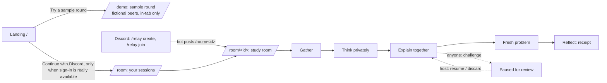

# Product journey, routes and states

**Don't just agree. Understand.** Your group explains it. RELAY checks a fresh problem.
RELAY is a Discord study-group assistant; the website is its companion, never a replacement.

## The journey

| Stage (UI) | Backend enum | The task that dominates | One primary action |
|---|---|---|---|
| Gather | `lobby` | who is here; optional schedule summary | host: Start |
| Think privately | `diagnostic` | the question, alone | Lock my answer (then host: Open discussion when the server allows) |
| Explain together | `discussion` | the reviewed hint, the peer explanation, the source | Share an explanation (host: Start the fresh problem once one exists) |
| Fresh problem | `transfer` | a different scenario, same idea, alone | Lock my answer (host: Close and reflect, or close the round recording missing) |
| Reflect | `debrief` | the private receipt | Open the full reflection |
| Paused | `challenge.pending` overlay | the concern and the source | host: Record the review |

The host's button is enabled only when `allowed_actions.advance.allowed`; otherwise the server's
`reason` is shown beside it. Participants see `waiting_on` and the same reason.

## Routes

| Route | Data | Notes |
|---|---|---|
| `/` | static | promise, sample CTA, live entry that states the real connection state |
| `/demo`, `/demo/debrief`, `/demo/present` | sample engine (`web/src/lib/sample.ts`) | one round per tab (sessionStorage); never calls `/api` or `/auth`; never a model |
| `/demo/stages` (+ `/schedule`, `/debrief`, `/present`) | captured backend fixtures | every stage and both points of view, read-only |
| `/room` | live | not connected (with reason) · local test identities · sign in · your sessions · no-session guidance |
| `/room/<id>` (+ `/schedule`, `/debrief`, `/present`) | live, polled every 3 s while visible | private view; `/present` uses the server's group-safe projection |

## Data modes (always labeled)

| Mode | Label | Source | Writes |
|---|---|---|---|
| Sample | "Sample round · fictional peers · original practice material" | in-browser engine, verified against backend replays | none leave the tab |
| Synthetic | "Synthetic session" | captured fixtures | none ("Demo only. Nothing was sent.") |
| Local test identities | amber banner | local backend with `RELAY_PUBLIC_DEMO=true` | local only, never production |
| Connected | chip with `live_model` / `delivery_enabled` flags as reported | the real backend through the proxy | yes, as the signed-in member |

A failed live request is never filled with sample data. With a view on screen, a failed poll keeps
the view and every unsent draft and says what happened (offline, signed out, removed, deleted).

## Connection states (`/connection`)

`connected` · `not_configured` · `invalid_url` · `local_address` · `unreachable` · `unhealthy`, then
sign-in required (401), not a member (403 "You haven't joined this session"), ready, reconnecting
(notice "Showing the last known view"). See `docs/LIVE_CONNECTION_DIAGNOSIS.md`.

## Privacy boundaries

The private view carries `my_answer`, `my_results`, `receipt`, `allowed_actions`; the presentation
view is a server-side allowlist without them (tested in Python and TypeScript). Group totals need three
paired responders. The sample pack is not a live concept, so its keys in the browser expose nothing real.
